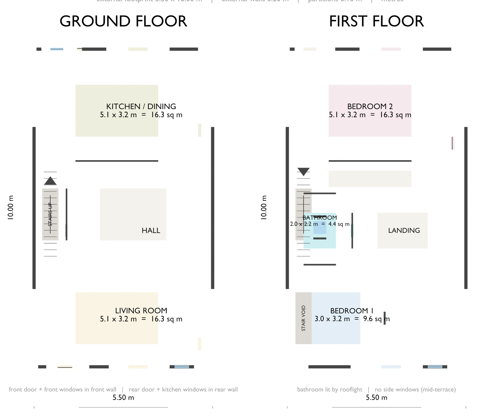

# Architect Floorplan — Hermes + Blender Experiment

An experiment in using an AI agent to turn a structured house specification into a
Blender-generated 2D floor plan — documented honestly, including the parts that went
wrong.

This is **not** a professional architectural design and has not been checked against
Building Regulations.

---

## Purpose

The question was narrow: can an agent carry a structured specification all the way to
a visible artefact?

```
Hermes designs / specifies the house
Hermes calculates dimensions and coordinates
Hermes writes the Blender Python
Blender generates the floor plan
Hermes visually checks the result
```

The answer turned out to be "yes, but not in the order originally planned".

---

## The architecture / specification challenge

Asking Hermes to invent a sensible architectural layout from scratch was the weak
point. Several proposed specifications were poor:

- bedrooms far too small or too narrow (one second bedroom was only 1.2 m deep)
- excessively large circulation and landing areas
- awkward room proportions
- stair dimensions that did not fit the available space
- unexplained leftover area, described loosely as "partitions"
- side windows on a house explicitly specified as a mid-terrace
- stated room areas that disagreed with the drawn geometry
- stairs overlapping other rooms
- the agent restarting a redesign instead of applying the feedback it was given

> **The experiment showed that the architectural specification needed to be
> constrained by the human (or ChatGPT) before Hermes was asked to generate the
> Blender geometry.**

---

## The Blender challenge

The first render that appeared to work was blank.

Hermes initially reported success because the PNG existed and contained black and
white pixels. That verification was inadequate — it could not distinguish a correct
render from an empty one.

When the image was actually inspected, the real problem was visible: **the two floors
had been physically stacked vertically**. A top-down orthographic camera therefore
saw only the first-floor slab, hiding the entire ground floor beneath it.

The fix was not a redesign. Both floor plans were presented **side by side at the same
Z level** for the 2D presentation — a drawing convention only.

> **File validation is not visual validation.**

---

## Final workflow

1. Human / ChatGPT defines a sensible basic architectural layout
2. Hermes converts it into precise coordinates
3. Hermes writes Blender Python; Blender builds the geometry
4. Workbench renders both floors side by side on white
5. Hermes inspects the rendered image itself
6. Presentation problems are fixed; the architecture is left alone

---

## Final image



Ground floor on the left, first floor on the right. Shows external and internal walls,
living room, kitchen/dining, hallway, staircase, two bedrooms, bathroom, landing,
doors, windows, room labels with areas, and dimension lines.

---

## Lessons

### What worked
- Hermes can generate and execute Blender Python
- Hermes can create structured geometry from coordinates
- Blender can produce the final 2D presentation
- Hermes can visually inspect its generated image
- Hermes can diagnose a genuine presentation error and correct it

### What didn't work
- Asking Hermes to freely invent the architecture
- Trusting textual claims that the render was correct
- Assuming a non-empty PNG means a useful image
- Stacking both floors and expecting a single top-down view to show both

### Main lesson
> AI agents are much more reliable when the human defines the important constraints
> and the agent handles the implementation.

---

## How long did it take?

This small proof-of-concept took considerably longer than expected, because most of
the iteration was spent getting the specification right and diagnosing whether the
Blender output was actually correct — not in writing Blender code.

---

## Stack

Hermes local AI agent · Blender 5.2 · Python · Blender Python API · Workbench render ·
Pillow · Git · GitHub Pages. Everything ran locally on Windows.

---

## Repo contents

| Path | Contents |
|------|----------|
| `index.html` | The documentation site |
| `style.css` | Styling (dark and light) |
| `generate_floorplan.py` | Blender script that builds and renders the plan |
| `make_diagrams.py` | Generates both diagrams with Pillow |
| `images/` | Final floor plan and the two diagrams |
| `docs/` | Specification and correction notes |

### Reproducing the render

```bash
blender --background --python generate_floorplan.py
```

### Regenerating the diagrams

```bash
python make_diagrams.py
```

---

## Live site

Repository: https://github.com/Jazblue/architectfloorplan

Pages: https://jazblue.github.io/architectfloorplan/